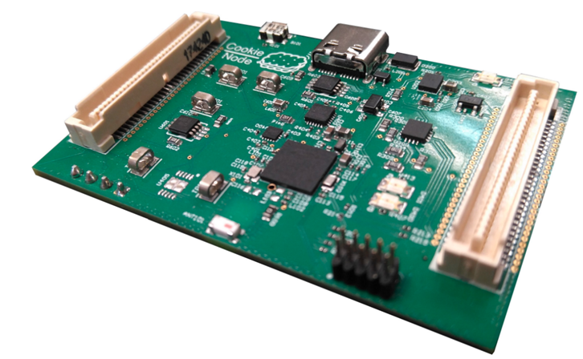

# Wireless Sensor Networks — Final Project

<!-- 🖼️ Optional: add a banner image at docs/images/banner.png and uncomment the line below -->
<!--  -->

    


> Final project of the **Wireless Sensor Networks** course (Máster en Electrónica Industrial, ETSII – UPM): **cooperative vehicle localization in a parking lot** using **RSSI** measurements between **Cookie** nodes running **Contiki-NG**.

<br>

### Index:

1. [Goal of the project](#goal-of-the-project)
2. [How it works](#how-it-works)
    - [System concept](#system-concept)
    - [Node roles](#node-roles)
3. [Repository structure](#repository-structure)
4. [Firmware](#firmware)
    - [Distance calculation](#distance-calculation)
5. [Hardware used](#hardware-used)
6. [Software & tools](#software--tools)
    - [Contiki-NG](#contiki-ng)
    - [Development environment](#development-environment)
7. [Team](#team)
8. [Project status](#project-status)

<br><br>

### Goal of the project

The goal of this project is to **locate the vehicles inside a parking lot** using a wireless sensor network, so that the occupancy of the lot can be known at any time — and, eventually, anyone can check how many spaces are free before arriving.

The use case is the parking lot of our own school (ETSII – UPM). Instead of deploying a sensor on every parking space, the system relies on:

- A **minimal fixed infrastructure**: only 1–2 Cookie nodes installed in the lot, acting as beacons.
- **One Cookie node per vehicle**, which joins the network when the car arrives.

This approach reduces the number of devices that have to be installed, powered and maintained in the parking lot itself.

<br><br>

### How this system works

#### System concept

1. **Fixed beacons:** 1–2 Cookie nodes are placed at known positions inside the parking lot.
2. **Vehicle arrival:** each arriving car carries its own Cookie node, which joins the network.
3. **Distance estimation:** nodes estimate their distance to their neighbours using the **RSSI** (Received Signal Strength Indicator) of the radio messages they exchange.
4. **Probabilistic localization:** an algorithm running **on the nodes themselves** combines these measurements to estimate where each car is. Rather than an exact position, the output is probabilistic: *"the car is most likely in this area"*.
5. **Cooperative refinement:** once located, every parked car becomes an additional reference point for the network. **The more cars in the lot, the more measurements are available and the more precise the localization becomes**, so the parking map is progressively filled in correctly.

```
        [B1] ·  ·  ·  ·  ·  ·  ·  ·  ·  ·  ·  [B2]        B  = fixed beacon (Cookie)
          \  RSSI                      RSSI /             C  = vehicle (Cookie)
           \                              /
            (C1) ─ ─ ─ ─ RSSI ─ ─ ─ ─ (C2)                Each new car adds new
               \                     /                    RSSI links → better
                \                   /                     position estimates
                 └ ─ ─  (C3)  ─ ─ ┘   ← new arrival
                   "probably in zone X"
```

<br>

#### Node roles

Following the communication models studied in the course, the nodes will implement two behaviours:

- **Server**
- **Client**

🚧 **Coming soon** — the responsibilities of each role and how they map to beacons and vehicles will be documented here once defined.

<br><br>

### Repository structure

```
Wireless-Sensor-Networks/
├── firmware/                    # Code that runs on the Cookie nodes
│   └── distance-calculation/    # RSSI-based distance measurement between nodes
├── tools/
│   └── images/                  # Used in this readme
├── docs/                        # 🚧 Coming soon
└── README.md
```

| Folder | Content | Status |
|---|---|:---:|
| [`firmware/`](/firmware) | Contiki-NG applications for the Cookie nodes | 🟢 |
| [`firmware/distance-calculation/`](/firmware/distance-calculation) | Distance estimation from RSSI measurements | 🟢 |
| [`tools/`](/tools) | Scripts and utilities to support development and testing | 🚧 |
| [`docs/`](/docs) | Documentation, diagrams and results | 🚧 |

<br><br>

### Firmware

#### Distance calculation

[`firmware/distance-calculation`](/firmware/distance-calculation) contains the code used to **estimate the distance between two Cookie nodes from the RSSI** of the received packets. This is the building block on which the localization algorithm will be developed.

<!-- ✏️ Add here: how the RSSI → distance conversion is done (model, calibration parameters), how to run the test and an example of the serial output. -->

<br><br>


### Hardware used



The project uses **Cookie** nodes: a modular wireless sensor platform with stackable layers (processing, radio communication, sensors and power), which makes it easy to adapt each node to the needs of the application.

In this project, the Cookie nodes play two parts:

- **Fixed beacons**, installed in the parking lot.
- **Vehicle nodes**, one per car.

All of them run **Contiki-NG** and communicate through their radio layer, which also provides the RSSI used for the distance estimation.

<br><br>

### Software & tools

#### Contiki-NG


[Contiki-NG](https://github.com/contiki-ng/contiki-ng) is an open-source operating system for resource-constrained IoT devices. It provides:

- An **event-driven kernel** based on processes and protothreads.
- A full **low-power IPv6 stack** (6LoWPAN, RPL, CoAP, MQTT…).
- Drivers and examples for many platforms.

Useful links:

- [Contiki-NG documentation](https://docs.contiki-ng.org/)
- [Contiki-NG GitHub repository](https://github.com/contiki-ng/contiki-ng)
- [Contiki-NG examples](https://github.com/contiki-ng/contiki-ng/tree/develop/examples)

<br><br>

#### Development environment


- **Editor:** VS Code.
- **Language:** C.
- **Toolchain:** Contiki-NG build system (`make`) with the cross-compiler for the node's microcontroller.
- **Serial monitor:** used to debug and check the messages printed by each node.

<br><br>


### Team

| Name | GitHub |
|---|---|
| **Jaime Pérez Pérez** | [@jimmyperezp](https://github.com/jimmyperezp) |
| **Adrián Riveiro Varela** | [@adrianrv](https://github.com/Adrv5005)  |

<br><br>

### Project status:

🟢 Active — RSSI distance measurement working; localization algorithm in development.  
🚧 Node roles (server / client), tools and docs: coming soon.  
🔭 User interface for free spaces: planned for later stages.

<br><br>

---------
Authors: Jaime Pérez Pérez & Adrián Riveiro Varela  
Course: Wireless Sensor Networks — Máster en Electrónica Industrial (ETSII-UPM)  
Last update: 17/11/2026

****